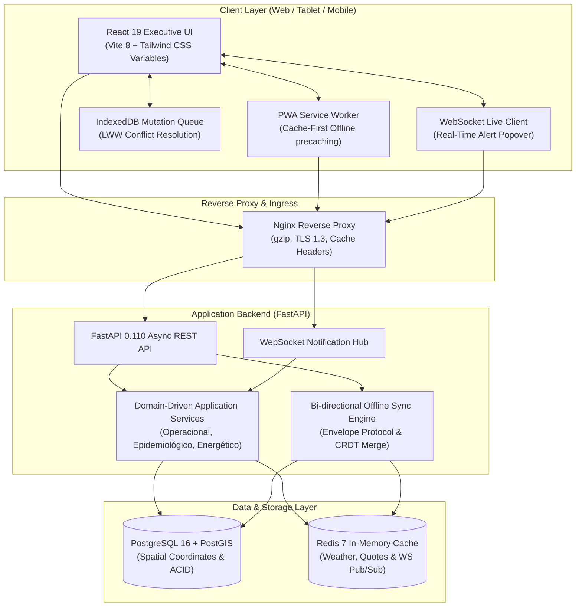

# Seed — Executive Agricultural Management & Field Intelligence Platform

[](https://github.com/Mendezalv/Seed/actions/workflows/ci.yml)
[](https://www.python.org/)
[](https://fastapi.tiangolo.com/)
[](https://postgis.net/)
[](https://react.dev/)
[](https://www.typescriptlang.org/)
[](https://web.dev/progressive-web-apps/)
[](LICENSE)

**Seed** is an enterprise-grade, offline-first agricultural intelligence ecosystem engineered for large-scale agribusinesses, grain growers, cooperatives, and agronomic management. Built with a Domain-Driven Architecture, **Seed** unifies real-time field telemetry, GIS plot mapping, phytosanitary epidemiological radar, fleet monitoring, economic feasibility hedging, and ESG carbon balance indicators into a unified executive cockpit.

---

## Key Features

- **Interactive GIS & Plot Telemetry (`/talhoes`):** Vector polygon mapping with PostGIS spatial geometry, NDVI satellite phenology indexes, crop staging (V6 to R5), variable-rate chemical application tracking, and soil moisture telemetry.
- **Crop Season Lifecycle Management (`/safras`):** Multi-season scheduling (Summer Soybeans, Second-Crop Corn, Cotton, Sugarcane), sowing-to-harvest Gantt charts, productivity benchmarks (bags/ha), and climatic stress forecasts.
- **Chemical Inventory & Batch Traceability (`/insumos`):** Phytosanitary warehouse stock control, active ingredient batch tracking, MAPA / inpEV regulatory compliance, quarantine alerts for expiring lots, and automated warehouse allocation.
- **Machinery Fleet & Telemetry (`/maquinarios`):** IoT connected harvesters, planters, and sprayers; operational engine hours, diesel fuel efficiency, and preventive/corrective maintenance work orders.
- **Economic Feasibility & Financial Hedging (`/viabilidade`):** Real-time break-even yield simulator, grain exchange quotes (CEPEA / B3 / CBOT), forward barter contracts, synthetic put option hedges, and per-plot EBITDA margins.
- **Phytosanitary Surveillance Radar (`/vigilancia`):** Asian Soybean Rust (*Phakopsora pachyrhizi*) and bollworm surveillance, spore dispersal climatic favorability index, neighbor-property infection vectors, and emergency field alerts.
- **Renewable Energy & ESG Carbon Accounting (`/energia-esg`):** GHG Protocol Scope 1 & 2 emissions calculation, solar photovoltaic generation offset, biomass biodigestion credits, and verified carbon credit issuance.
- **Real-Time WebSocket Notifications:** Bidirectional live alerts push notifications for telemetric thresholds, maintenance schedules, and epidemiological risks.
- **Offline-First PWA Architecture:** Progressive Web App powered by Service Workers, Workbox asset precaching, client-side IndexedDB mutation queues, and Last-Write-Wins (LWW) conflict resolution for seamless operation in zero-connectivity field zones.

---

## System Architecture



---

## Technology Stack

| Layer | Technology | Description |
| :--- | :--- | :--- |
| **Frontend** | React 19, TypeScript 6, Vite 8, React Router v7 | Dark Zinc (`#09090b`) & Emerald (`#10b981`) Executive Design System |
| **PWA & Offline** | `vite-plugin-pwa`, Workbox, IndexedDB | Service Worker caching, background sync, offline forms |
| **Backend** | Python 3.12+, FastAPI, Uvicorn | Asynchronous REST & WebSocket backend |
| **Database** | PostgreSQL 16 with PostGIS | Geospatial polygons, multi-tenant schemas, Alembic migrations |
| **Caching & Messaging** | Redis 7, Celery | Market quote caching, weather API caching, background jobs |
| **E2E Testing** | Playwright (`@playwright/test`) | Chromium end-to-end automated user journey tests |
| **Backend Testing** | Pytest, Pytest-AsyncIO, Factory Boy | Unit and integration tests with coverage reporting |
| **Code Quality** | Ruff, Oxlint | High-performance Python & TypeScript linters |
| **Containerization** | Docker, Docker Compose, Nginx Alpine | Multi-stage production container images |

---

## Quick Start

### 1. Running with Docker Compose (Production Environment)

To launch the complete production stack (Database, Redis, FastAPI Backend, and Nginx-powered React Frontend):

```bash
# 1. Clone the repository
git clone https://github.com/Mendezalv/Seed.git
cd Seed

# 2. Copy the production environment template
cp .env.prod.example .env.prod

# 3. Launch all containers
docker compose -f docker-compose.prod.yml up -d --build
```

The services will be available at:
- **Frontend PWA:** [http://localhost:80](http://localhost:80)
- **FastAPI API & OpenAPI Docs:** [http://localhost:8000/docs](http://localhost:8000/docs)
- **Health Check Endpoint:** [http://localhost:8000/health](http://localhost:8000/health)

---

### 2. Local Development Setup

#### Prerequisites
- Python 3.12 or newer
- Node.js 20 or newer (`npm`)
- Docker & Docker Compose (for local PostgreSQL and Redis)

#### Step 1: Start Database and Cache
```bash
docker compose up -d db redis
```

#### Step 2: Configure and Run Backend
```bash
# Create and activate Python virtual environment
python -m venv .venv
source .venv/bin/activate  # On Windows: .venv\Scripts\Activate.ps1

# Install dependencies in editable mode
pip install -e ".[dev]"

# Copy environment variables
cp .env.example .env

# Run database migrations
alembic upgrade head

# Start FastAPI development server
uvicorn src.main:app --host 127.0.0.1 --port 8000 --reload
```

#### Step 3: Configure and Run Frontend PWA
```bash
cd frontend

# Install Node dependencies
npm install

# Start Vite development server
npm run dev
```

The frontend development server will run at [http://127.0.0.1:5173](http://127.0.0.1:5173), reverse-proxying API calls directly to port `8000`.

---

## Test Suites

The project features a comprehensive test pyramid with 100% pass rates across all layers.

### Backend Unit & Integration Tests
```bash
# Run unit tests
pytest tests/unit/ -v

# Run integration tests (requires active database and redis or mock client)
pytest tests/integration/ -v

# Run full test suite with code coverage
pytest tests/ -v --cov=src --cov-report=term-missing
```

### Frontend End-to-End (E2E) Tests (Playwright)
The automated E2E suite runs in headless Chromium against the frontend development server:

```bash
cd frontend

# Run all 12 E2E user journey tests
npm run test:e2e

# Run with interactive UI mode
npx playwright test --ui
```

### Linters & Code Standards
```bash
# Python linting and formatting
ruff check src/ tests/
ruff format --check src/ tests/

# Frontend TypeScript linting
cd frontend && npm run lint
```

---

## Offline-First & Synchronization Mechanics

In agricultural and remote field regions, mobile network coverage is often intermittent or non-existent. **Seed** addresses this with a resilient two-way offline architecture:

1. **Service Worker Caching:** Static bundles, stylesheets, Google Fonts, and application shells are precached upon first visit. The application boots instantaneously offline.
2. **IndexedDB Local Store:** When users perform field operations (recording input deliveries, logging pest sightings, or updating field notes), mutations are assigned an immutable UUID, stamped with client-side metadata, and enqueued locally.
3. **Optimistic UI Updates:** The user interface reflects state changes immediately without waiting for network acknowledgment.
4. **Reactive Reconnection:** A global `online` window listener triggers automatic background synchronization when internet connectivity resumes.
5. **Conflict Resolution:** The synchronization engine applies **Last-Write-Wins (LWW)** timestamps and **CRDT G-Counter** strategies to reconcile changes between field tablets and central headquarters.

---

## Project Structure

```
Seed/
├── .github/workflows/          # CI/CD pipelines (GitHub Actions)
├── alembic/                    # Database migration scripts
├── docker-compose.yml          # Local development stack
├── docker-compose.prod.yml     # Production hardened stack
├── Dockerfile                  # Multi-stage Backend Docker image
├── frontend/                   # React 19 + TypeScript Frontend
│   ├── e2e/                    # Playwright End-to-End tests
│   │   ├── auth-navigation.spec.ts
│   │   ├── modals-and-forms.spec.ts
│   │   └── notifications.spec.ts
│   ├── public/                 # PWA icons, manifest, SVG assets
│   ├── src/
│   │   ├── api/                # API client with offline interceptors
│   │   ├── components/         # Reusable UI widgets, layout and modals
│   │   ├── context/            # Auth, Sync, and Notification contexts
│   │   ├── pages/              # 8 Executive view screens
│   │   ├── services/           # Service layer interfaces
│   │   ├── App.tsx             # Protected routes and navigation shell
│   │   └── main.tsx            # PWA Service Worker bootstrap
│   ├── Dockerfile              # Multi-stage Frontend Nginx container
│   ├── nginx.conf              # Production Nginx reverse-proxy config
│   ├── package.json
│   ├── playwright.config.ts    # Playwright configuration
│   └── vite.config.ts          # Vite configuration with VitePWA
├── src/                        # FastAPI Backend Application
│   ├── domain/                 # SQLAlchemy 2.0 ORM models
│   ├── application/            # Business logic and domain services
│   ├── api/                    # Route handlers and dependency injection
│   ├── shared/                 # Cache, Auth, DB session, WebSocket hub
│   └── sync_engine/            # Offline envelope and conflict resolution
├── tests/
│   ├── unit/                   # Unit test suite (Cache, ESG, Alertas, Viabilidade)
│   └── integration/            # Flow integration tests (Health, Spatial, GIS, WS)
└── README.md
```

---

## License

This project is licensed under the **MIT License**. See the [LICENSE](LICENSE) file for details.
